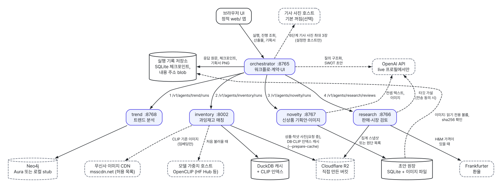

# Fashion Planner

**트렌드 근거가 붙은 신상품 기획안을 만드는 학습용 멀티 에이전트 시스템입니다.** MD가 "2027년 봄 발레코어에서 유행하는 핑크색 상의를 기획하고 싶어"처럼 요청하면, 다섯 서비스가 트렌드·재고·신상품 기획·판매 검토를 차례로 처리해 한 장짜리 기획서 PNG를 만듭니다.

<picture>
  <source media="(prefers-color-scheme: dark)" srcset="system-dark.png">
  
</picture>

## 레포

| 레포 | 역할 |
|---|---|
| [fashion-planner-orchestrator](https://github.com/KG-RAG-02/fashion-planner-orchestrator) | 기획 질의 구조화, 6단계 워크플로 실행, 웹 UI, 기획서 PNG, Docker 통합 배포. **여기서 시작하세요.** |
| [fashion-planner-trend](https://github.com/KG-RAG-02/fashion-planner-trend) | Vogue Korea 기사에서 트렌드 추출, Neo4j 지식 그래프, 유사 상품 검색 |
| [fashion-planner-inventory](https://github.com/KG-RAG-02/fashion-planner-inventory) | 트렌드에 맞는 과잉재고 상품 매칭(규칙 + CLIP) |
| [fashion-planner-novelty](https://github.com/KG-RAG-02/fashion-planner-novelty) | 트렌드 기반 신상품(novelty) 기획안과 제품·착장 이미지 생성 |
| [fashion-planner-research](https://github.com/KG-RAG-02/fashion-planner-research) | 기획안의 판매·시장 조사(가격, 원단 원가, 고객 연령, 타깃) |

## 빠르게 실행해 보기

다섯 레포를 같은 폴더에 나란히 받은 뒤, orchestrator의 stub 프로필로 전체 워크플로를 실행할 수 있습니다. stub 프로필은 합성 데이터만 쓰고 외부 키와 비용이 없습니다. 자세한 절차는 [orchestrator README](https://github.com/KG-RAG-02/fashion-planner-orchestrator#readme)에 있습니다.

## 고지

- 학습·교육 목적의 비상업 프로젝트입니다. Condé Nast, Vogue Korea(두산매거진), 무신사, H&M과 관련이 없으며 이들의 승인이나 후원을 받지 않았습니다. 'Vogue'는 해당 권리자의 상표입니다.
- 레포에는 제3자 데이터(기사 원문, 이미지, 상품·거래 데이터)가 들어 있지 않습니다.
- 코드는 각 레포의 MIT 라이선스로 배포합니다. MIT 라이선스는 외부 데이터셋과 그 파생물에는 적용되지 않습니다.

만든 사람들: [Ryu-Jemu](https://github.com/Ryu-Jemu)(류제무), [5aro](https://github.com/5aro), [Chaewon-Leee](https://github.com/Chaewon-Leee)(이채원), [ley0n7](https://github.com/ley0n7)(이윤지)
